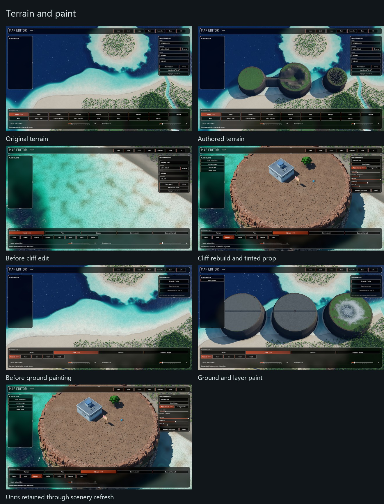
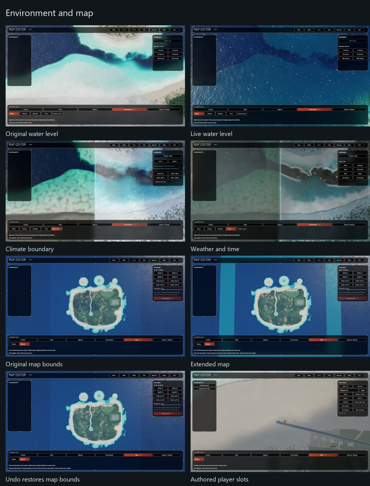
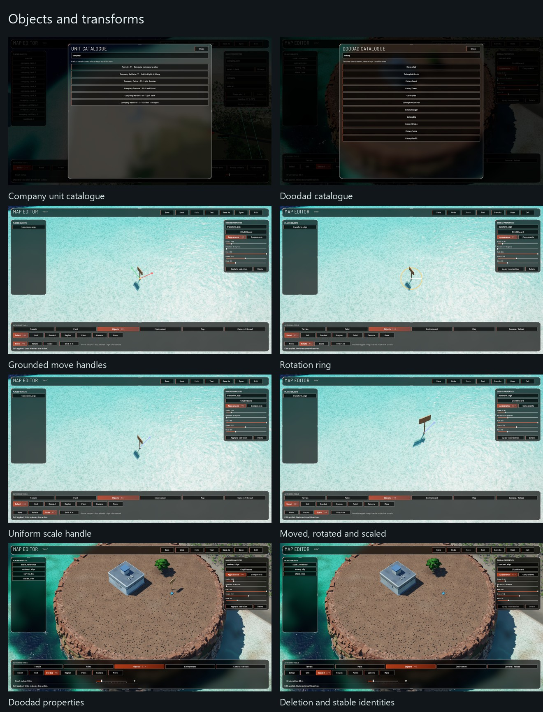
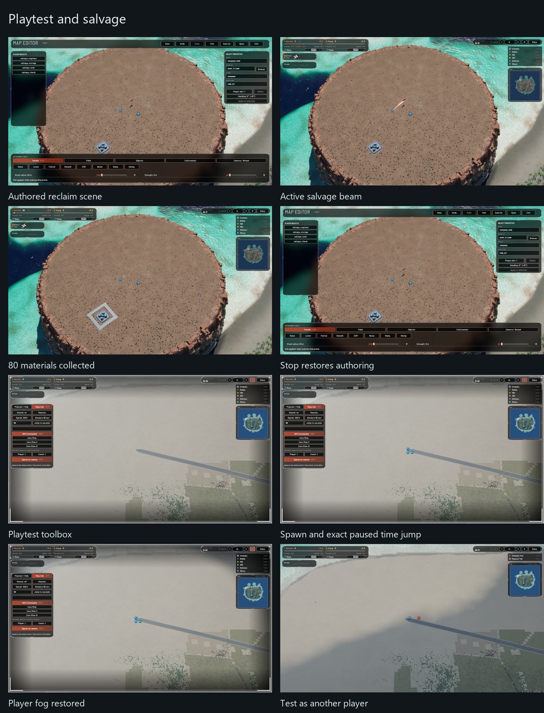
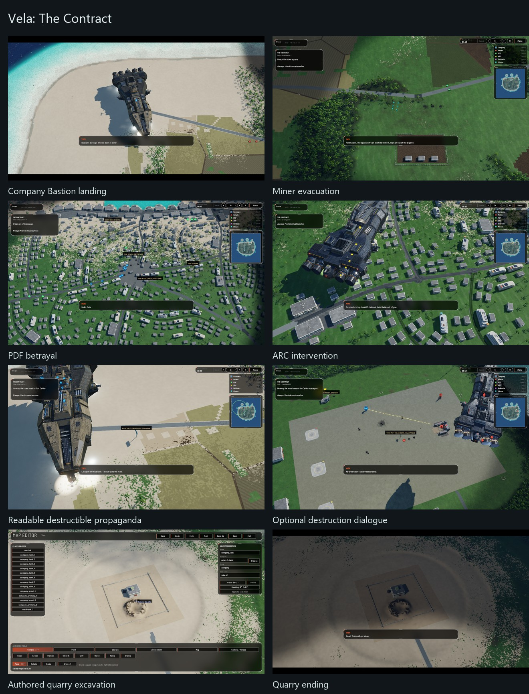
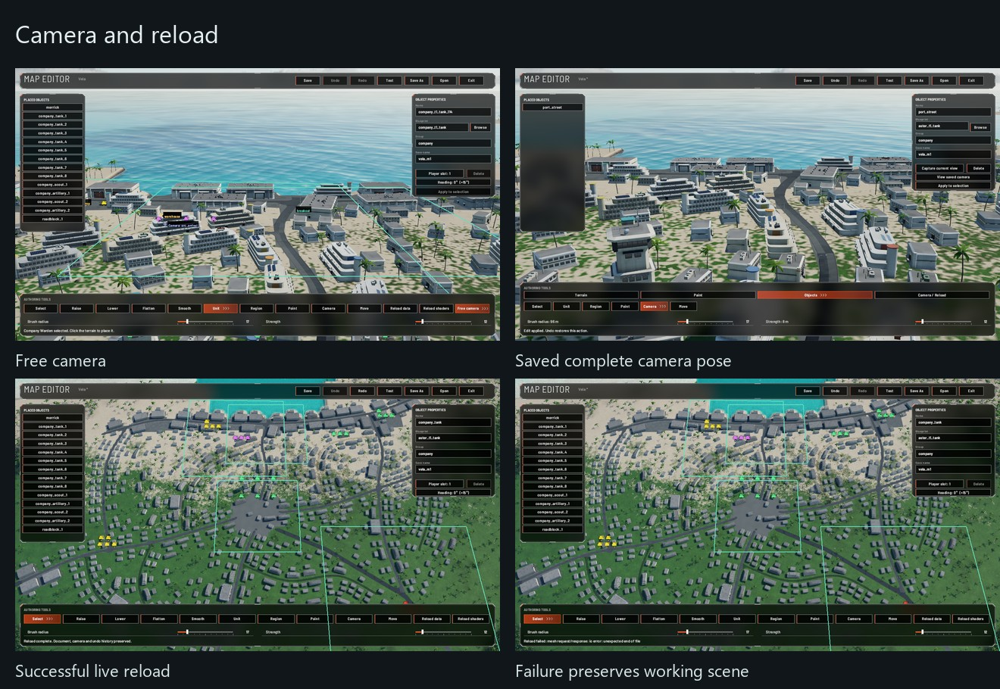

# Native editor and Vela screenshots

These are native Windows Vulkan captures from the implementation worktree.
Earlier editor captures document individual checks; the final Vela views include
the completed propaganda and quarry work. Each sheet is a labelled contact sheet,
not concept art. Click a sheet to inspect it at its stored resolution.

## Terrain and paint

## Environment and map

## Objects and transforms

## Playtest and salvage

## Vela: The Contract

## Camera and reload

See [implementation and verification](EDITOR-IMPLEMENTATION.md) for tested
behavior, reproduction notes and remaining player-review boundaries.
